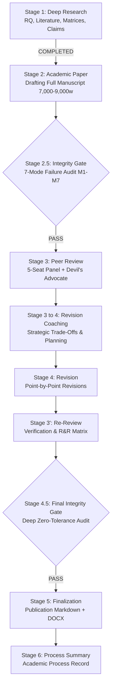

# Project Master Index: Spec Ops: The Line Academic Investigation

**Project:** Do You Feel Like a Hero Yet? Narrative Deception, Moral Complicity, Psychological Deterioration, and the Ethics of Play in *Spec Ops: The Line*  
**Repository Working Directory:** `research/spec-ops-the-line/`  
**Pipeline Framework:** Academic Research Skills (ARS v3.24.1)  
**Status:** Stage 1 (`deep-research`) Complete; Advancing to Stage 2 (`academic-paper`)  
**Timestamp:** 2026-11-03 14:37:00 +06:00  

---

## 1. Master File Registry and Deliverables

| Deliverable File | Description and Core Contents | Status | Stage Origin |
|---|---|---|---|
| `README.md` | Core project introduction, scope summary, and repository guide. | Complete | System Initialization |
| `dev-log.md` | Chronological execution log tracking all stages, commits, and verification runs. | Active / Updated | User Workflow Rule |
| `context.md` | Project goals, academic disciplines, word counts, and tooling specifications. | Complete | System Initialization |
| `CHANGELOG.md` | Semantic versioned history of project artifacts and analytical changes. | Active / Updated | User Workflow Rule |
| `00_PROJECT_README.md` | Master project index, stage verification status, and architectural map. | Complete | Stage 1 (`deep-research`) |
| `01_RESEARCH_BRIEF.md` | Core research questions (RQ1–RQ8), provisional central arguments, and scope. | Complete | Stage 1 (`deep-research`) |
| `02_SEARCH_STRATEGY_AND_LOG.md` | Search queries, database sources, screening criteria, and 32 included records. | Complete | Stage 1 (`deep-research`) |
| `03_ANNOTATED_BIBLIOGRAPHY.md` | 32 verified sources with APA 7 citations, summaries, relevance, and evaluations. | Complete | Stage 1 (`deep-research`) |
| `04_LITERATURE_SYNTHESIS.md` | Thematic state of research across 5 domains and 4 critical research gaps. | Complete | Stage 1 (`deep-research`) |
| `05_SCENE_ANALYSIS_MATRIX.md` | Exhaustive 15-chapter and epilogue scene-level ludonarrative matrix. | Complete | Stage 1 (`deep-research`) |
| `06_CHARACTER_ANALYSIS_MATRIX.md` | Multidimensional 11-category profiles for all primary, secondary, and collective actors. | Complete | Stage 1 (`deep-research`) |
| `07_EVIDENCE_AND_CLAIM_MATRIX.csv` | Traceable database linking 15 formal claims to in-game evidence and citations. | Complete | Stage 1 (`deep-research`) |
| `references.bib` | Complete BibTeX export containing all 32 verified bibliographic entries. | Complete | Stage 1 (`deep-research`) |
| `08_FULL_RESEARCH_PAPER.md` | Complete academic manuscript (7,000–9,000 words, APA 7th edition). | In Drafting | Stage 2 (`academic-paper`) |
| `09_PEER_REVIEW.md` | Multi-perspective 5-seat peer review panel and Devil's Advocate critiques. | Pending | Stage 3 (`academic-paper-reviewer`) |
| `10_REVISION_AND_INTEGRITY_REPORT.md` | Revision history, point-by-point response, 7-mode AI integrity check, APA audit. | Pending | Stage 4 & Gate 2.5/4.5 |
| `11_PROCESS_RECORD.md` | Final academic process record, self-reflection, and collaboration documentation. | Pending | Stage 6 (`academic-pipeline`) |

---

## 2. ARS Pipeline Stage Progression

Stage 1 is formally validated with zero missing artifacts. Advancing to Stage 2 drafting.
