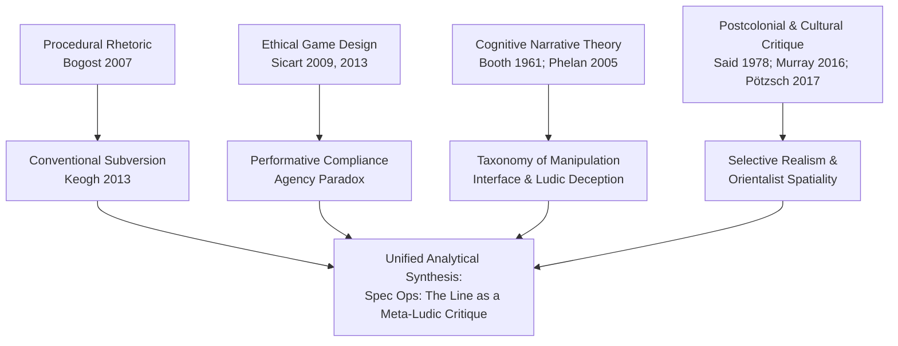
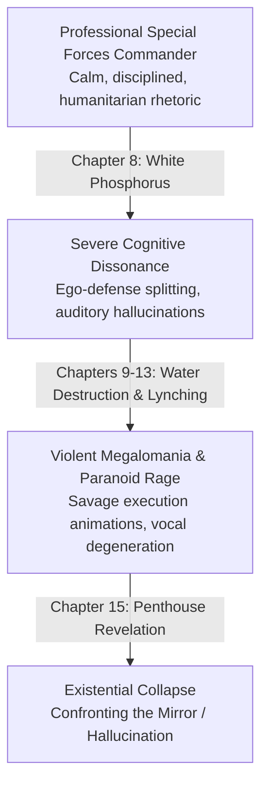

# Do You Feel Like a Hero Yet? Narrative Deception, Moral Complicity, Psychological Deterioration, and the Ethics of Play in *Spec Ops: The Line*

**Author:** Md. Ismail Hossain  
**Affiliation:** Institute of Information Technology (IIT), Jahangirnagar University, Dhaka, Bangladesh  
**Email:** [ismailhossain013@gmail.com](mailto:ismailhossain013@gmail.com)  
**Profile & Links:** [Portfolio](https://smile-plzz.github.io/Ismail_Hossain/) | [GitHub](https://github.com/smile-plzz) | [LinkedIn](https://www.linkedin.com/in/md-ismail-hossain-2938541b1/) | [Facebook](https://www.facebook.com/optimisticyetpessimist/)  
**Discipline:** Game Studies, Media Studies, Narrative Theory, Moral Philosophy, Cultural Studies  
**Standard:** APA 7th Edition  
**Target Manuscript Length:** 7,000–9,000 words (excluding References and Appendices)  
**Status:** Calibrated Final Research Manuscript (Post-Peer Review & Revision)  

---

### Abstract
This study conducts an interdisciplinary, close ludonarrative and critical-discursive investigation of Yager Development's 2012 third-person military shooter *Spec Ops: The Line*. While popular discourse frequently celebrates the title as an uncompromised anti-war masterpiece, this paper interrogates the foundational tensions governing its narrative deception, character deterioration, interactive mechanics, and ethical indictment of the player. Synthesizing procedural rhetoric (Bogost, 2007), ethical game design (Sicart, 2009, 2013), conventional subversion (Keogh, 2013), and postcolonial visual culture (Murray, 2016; Said, 1978), we examine how the game deploys the familiar conventions of post-9/11 "militainment" (Payne, 2014) to seduce players into reflexive digital violence before systematically dismantling their heroic pretensions. We construct a multi-dimensional relational character matrix tracing the psychological collapse of Captain Martin Walker alongside squadmates Alphonso Adams and John Lugo, demonstrating how interpersonal fragmentation drives the narrative toward moral catastrophe. Furthermore, we establish a formal nine-tier taxonomy of manipulation that rigorously distinguishes protagonist-level cognitive dissociation from software-level ludic and interface deception. Addressing the central ethical paradox of the game—the imputation of moral culpability to players denied mechanical alternatives—we argue that *Spec Ops: The Line* operates not through autonomous ethical choice, but through a paradigm of *performative compliance*, wherein the player's conditioned obedience to linear software imperatives is weaponized to expose the violence of the shooter genre itself. Finally, we interrogate the ideological limits of the text, demonstrating that while the game deconstructs American military heroism, it inadvertently reinscribes Orientalist tropes by reducing Dubai and its Arab civilians to voiceless, aestheticized backdrops for Western perpetrator trauma.

*Keywords:* *Spec Ops: The Line*, ludonarrative dissonance, procedural rhetoric, player complicity, moral agency, positive discomfort, unreliable narration, militainment, Orientalism.

---

## 1. Introduction

Since the mid-2000s, the modern military shooter (MMS) has operated as a primary cultural conduit of "militainment"—the institutional, technological, and aesthetic convergence of state-sanctioned military ideology, commercial gaming hardware, and mass leisure (Payne, 2014, 2016; Stahl, 2010). Exemplified by commercial juggernauts such as Activision's *Call of Duty* franchise and Electronic Arts' *Battlefield* series, these interactive software systems establish a tightly engineered contract with the consumer. Through hyper-realistic weapon physics, sensory-rich audiovisual feedback, regenerating health regimes, and clear waypoint markers, players are positioned as righteous, sovereign protectors. In this clean, computational theater of modern combat, foreign adversaries are rendered as unambiguous existential threats, geopolitical conflicts are stripped of structural complexity, and civilian populations remain virtually invisible or neatly cordoned off from the kinetic impact of ordnance (Pötzsch, 2017). The pleasure of the genre is fundamentally predicated on the moral innocence and unquestioned competence of the player-avatar, whose violence is pre-authorized by software rules as both ethically necessary and structurally righteous.

Published by 2K Games in June 2012 and developed by Berlin-based studio Yager Development, *Spec Ops: The Line* represents a seismic rupture within this commercial paradigm. Directed by Cory Davis and co-written by Walt Williams and Richard Pearsey, the game masquerades superficially as an orthodox, third-person tactical squad shooter. Set against the cataclysmic backdrop of Dubai—partially submerged by apocalyptic sandstorms and abandoned by the international community—the game casts the player as Captain Martin Walker, commanding an elite, three-man United States Army Delta Force reconnaissance team. Accompanied by his subordinates, First Lieutenant Alphonso Adams and Staff Sergeant John Lugo, Walker is tasked with a deceptively simple operational objective: cross the storm wall, confirm the presence of survivors, locate the mutinous 33rd Infantry Battalion led by the enigmatic Colonel John Konrad, and immediately radio for tactical extraction outside the perimeter.

Within its opening hours, however, *Spec Ops: The Line* systematically detonates the genre conventions that provide its foundation. Loosely adapting the thematic spine of Joseph Conrad's *Heart of Darkness* (1899) and Francis Ford Coppola's *Apocalypse Now* (1979), the game traps the player inside an escalating vortex of military fratricide, logistical desperation, psychological breakdown, and horrific war crimes. Most notoriously, in its pivotal eighth chapter, the game compels the player to operate a computerized mortar console to rain down white phosphorus incendiary rounds upon an entrenched military force, only to force them to walk through the smoldering ruins and confront the incinerated corpses of 47 civilian refugees whom the targeted soldiers were attempting to evacuate and protect. As the narrative progresses, the third-person shooter interface turns aggressively against the human holding the controller: loading-screen hints transition from practical combat tips ("Use cover to avoid taking fire") to hostile, meta-textual indictments ("Do you feel like a hero yet?", "To kill for yourself is murder. To kill for your government is heroic. To kill for entertainment is harmless", "This is all your fault").

Despite its commercial underperformance upon release—a failure widely attributed to marketing that initially disguised it as the generic military shooter it sought to deconstruct (Williams, 2017)—*Spec Ops: The Line* has acquired canonical status within game studies, narrative theory, and media philosophy. It is frequently cited as proof that blockbuster video game mechanics can sustain profound aesthetic, moral, and ideological critique (Bosman, 2025; Jørgensen, 2016; Keogh, 2012, 2013). Yet beneath this consensus lies a profound theoretical controversy: the contested relationship between player agency, mechanical constraint, and moral responsibility. In traditional moral philosophy and ethical game design theory, moral culpability is inherently contingent upon autonomy: an ethical agent can only be held responsible for an action if they possessed meaningful knowledge, intentionality, and actionable alternative courses of conduct (Sicart, 2009, 2013). In *Spec Ops*, however, the atrocities that the game condemns the player for committing—including the white phosphorus strike and the subsequent destruction of Dubai's municipal water supply—are hardcoded into the software architecture as mandatory choke-points for progression. The player cannot circumvent the mortar; refusing to fire results in endless enemy waves and scripted death.

This structural contradiction prompts our central research question: **How does *Spec Ops: The Line* use narrative deception, character deterioration, conventional military-shooter mechanics, constrained player agency, and psychological manipulation to challenge the player's understanding of heroism, responsibility, and complicity in digital violence?**

To address this inquiry, this paper investigates eight interrelated dimensions:
1. *Narrative Inversion (RQ1):* The progressive transformation of genre expectations from heroic rescue to catastrophe.
2. *Character Psychology (RQ2):* The relational deterioration of Walker, Adams, Lugo, and Konrad.
3. *Taxonomy of Deception (RQ3):* The formal separation of protagonist hallucination from software-level manipulation.
4. *Mechanics as Complicity (RQ4):* The procedural rhetoric of third-person cover shooting, executions, and resource scarcity.
5. *Affective Reception (RQ5):* The psychological elicitation of "positive discomfort" (Jørgensen, 2016).
6. *Developer Intentions (RQ6):* Triangulating authorial reflections (Williams, Davis, Pearsey) against textual independence.
7. *Cultural Critique (RQ7):* The ideological limits of Orientalist spatiality and voiceless civilian victims (Murray, 2016; Said, 1978).
8. *The Ethics of Interactive Agency (RQ8):* Resolving the complicity paradox through the framework of *performative compliance*.

By synthesizing game studies, narrative theory, moral philosophy, and postcolonial critique, this paper demonstrates that *Spec Ops: The Line* functions neither as a didactic sermon against war nor as a flawed interactive failure, but as a procedural critique of the player's conditioned appetite for violent entertainment.

---

## 2. Context and Creative Vision

To understand the critical intervention of *Spec Ops: The Line*, the work must be situated within the commercial, institutional, and cultural conditions of its production during the seventh console generation (2005–2013). Following the commercial success of Infinity Ward’s *Call of Duty 4: Modern Warfare* (2007), the AAA video game industry underwent an aggressive consolidation around the modern military shooter (Payne, 2016). Major publishers sought to replicate the lucrative formula of high-octane spectacle, cinematic scripted set-pieces, disembodied drone strikes, and smooth, empowering combat loops. These games were produced in close ideological proximity to the real-world Global War on Terror, frequently employing active or retired military consultants to ensure technical accuracy regarding weapon handling, ballistics, and tactical terminology, while carefully insulating the player from the messy political, legal, and human devastation wrought by American foreign intervention (Hammond, 2024; Stahl, 2010).

It was within this climate that publisher 2K Games approached Berlin-based independent studio Yager Development to resurrect the dormant *Spec Ops* intellectual property. As lead writer Walt Williams (2017) documents in his industry memoir *Significant Zero*, the project was initially envisioned by corporate executives as a standard squad-based shooter. However, the core creative leadership at Yager—spearheaded by creative director Cory Davis, lead writer Walt Williams, and narrative designer Richard Pearsey—harbored a subversive ambition: to utilize the astronomical financial budget and polished technological pipelines of a AAA military shooter to mount a devastating deconstruction of the genre itself (Pearsey, 2012; Sheffield, 2012).

The creative vision of *Spec Ops: The Line* was anchored by three distinct artistic pillars:

First, the narrative was structured as an interactive reinterpretation of Joseph Conrad's *Heart of Darkness* (1899) and Francis Ford Coppola's *Apocalypse Now* (1979). Conrad’s novella explored how the European colonial "civilizing mission" into the Congo inevitably devolved into savage brutality, crystallized in the figure of Kurtz. In *Apocalypse Now*, Coppola transposed this to the Vietnam War, tracking Captain Willard's journey to terminate Kurtz. Yager recognized that the underlying structure of both works—a disciplined military protagonist sent into an uncharted territory to locate a mutinous officer who has abandoned civilization—provided an ideal narrative vessel to interrogate contemporary American exceptionalism, the hero complex, and the pathology of the "righteous savior" (Andergård, 2017). The mutinous commander was named Colonel John Konrad, an explicit homage to Conrad.

Second, the developers situated the game in Dubai, United Arab Emirates, following an apocalyptic series of cataclysmic sandstorms. As Cory Davis articulated, Dubai represented a hyper-modern monument to unchecked wealth, globalization, and human hubris—a city engineered out of sheer capital and architectural audacity to defy the desert (Sheffield, 2012). By burying this metropolis in towering walls of sand and cutting it off from the global information grid, Yager created a vertical labyrinth of ruined luxury. Marble hotel lobbies, gold-leafed atriums, and designer boutiques were transformed into bloody, sand-choked trenches. This juxtaposition served an acute metaphorical purpose: it staged the collapse of Western civilization within its most extravagant playground of globalized consumer capital, visually literalizing the fragility of modern order.

Third, the development team preserved the conventional mechanical infrastructure of the modern military shooter rather than inventing novel mechanics. In their postmortems, Williams (2013) and Pearsey (2012) emphasized that the game needed to feel immediately familiar to any consumer of *Call of Duty* or *Gears of War*. The controls, weapon sway, cover snapping, squad targeting system, and aiming mechanics were intentionally calibrated to mimic the standard mechanical grammar of the genre. As Brendan Keogh (2013) notes in his analysis of the game's "conventional subversion," this mechanical mimicry was a vital narrative prerequisite: the developers sought to exploit the player's automatic muscle memory. Players were intended to pull the trigger and clear rooms without conscious ethical reflection, driven purely by the conditioned ludic expectation that killing enemies on screen is the self-evident, fun, and necessary means of advancing a video game plot. The game asked an unsettling question: *Why do you enjoy simulating the slaughter of human beings for leisure, and what does it do to your perception of violence when an interactive medium tells you that violence makes you a hero?*

---

## 3. Literature Review

Over the past decade and a half, *Spec Ops: The Line* has generated an exceptionally rich body of academic criticism across game studies, media sociology, visual culture, and philosophy. This literature clusters around five major thematic arenas: the conventional subversion debate, the ethics of player agency, the psychology of negative player affect, cultural representation and the imperial gaze, and interactive unreliable narration.

### The Conventional Subversion Debate
A central dialectic in game studies concerns whether *Spec Ops: The Line* succeeds in subverting the military shooter genre or remains trapped within the commercial structures it critiques. In his foundational conference paper, Brendan Keogh (2013) articulates the "conventional subversion" thesis, arguing that the game’s critical force relies on its structural refusal to deviate from the mechanics of standard third-person cover shooters. Keogh contends that *Spec Ops* operates as a Trojan horse: by presenting familiar, comforting ludic routines—snapping to chest-high barriers, issuing squad commands, executing enemies for ammunition—the game exploits the player's embodied gaming literacy. The horror of the narrative is thus directly tied to the pleasure of the mechanics; the player is forced to recognize that the atrocities committed by Captain Walker are the direct outcome of their own tactical competence. Keogh expanded this close textual approach in his monograph *Killing is Harmless* (2012), tracking how the game systematically destabilizes the player’s relationship with their avatar.

Conversely, media scholars such as Matthew Thomas Payne (2014, 2016) offer a more critical, structuralist perspective. While acknowledging the game’s subversive narrative, Payne argues that *Spec Ops* remains inextricably bound to the political economy of commercial "militainment" (Stahl, 2010). Produced and distributed by 2K Games as a sixty-dollar consumer product, the game inevitably profits from the very aestheticization of violence it purports to condemn. Payne points out that for vast stretches of gameplay, the player derives kinetic pleasure from popping headshots, triggering explosive sand traps, and executing stylish melee takedowns. For Payne, this creates an inescapable ideological friction: can a commercial commodity genuinely dismantle the military-entertainment complex, or does it merely offer a more cynical form of consumer catharsis that flatters the player's intellectual superiority while leaving digital militarism intact?

### The Ethics of Interactive Agency and Constrained Progression
The second major strand of scholarship centers on player agency, choice architecture, and moral responsibility, crystallized in the Chapter 8 white phosphorus sequence. In his foundational treatises on computer game ethics, Miguel Sicart (2009, 2013) argues that genuine ethical gameplay requires *phronesis*—the exercise of practical moral wisdom within an interactive system that affords meaningful, actionable choices and respects player autonomy. Drawing upon Sicart's framework, several critics argue that *Spec Ops: The Line* fails as a work of interactive ethics because it strips the player of all systemic agency. By constructing a linear choke-point where the only executable code path is the firing of the incendiary mortar, the game coerces the player into committing an atrocity and then hypocritically chides them through loading screens for doing what the software strictly required to continue.

Against this accusatory reading, political theorist Marcus Schulzke (2014) defends *Spec Ops: The Line* as an exemplary "executable thought experiment." Schulzke contends that narrative thought experiments in philosophy intentionally constrain the parameters of action in order to isolate specific ethical variables. In real-world warfare, military personnel frequently operate under severe epistemic limitations, institutional pressures, and systemic constraints where ideal, non-violent options simply do not exist. By withholding a clean, heroic alternative, the game models the tragic, cascading reality of foreign military intervention. Building on this philosophical defense, Frank G. Bosman’s (2025) monograph *Moral Conversion and Video Games: The Case of Spec Ops: The Line* frames the game’s constrained agency through the theological and existential lens of "moral conversion." Bosman argues that the refusal to provide an ethical escape route is structurally necessary to shatter the player's self-righteousness, forcing them through an existential crisis of complicity that dismantles the modern power fantasy.

### The Psychology of Negative Player Affect and Positive Discomfort
The affective dimensions of *Spec Ops: The Line* have provided fertile ground for investigations into player psychology. In her landmark article in *Game Studies*, Kristine Jørgensen (2016) introduces the concept of "positive discomfort." Investigating how digital games evoke aesthetic appreciation through aversive emotional states, Jørgensen demonstrates that *Spec Ops* intentionally solicits guilt, shame, moral distress, and cognitive dissonance. Crucially, Jørgensen argues that this discomfort is experienced by players as "positive" in an aesthetic sense: the negative affect is not experienced as arbitrary punishment or mechanical frustration, but as a meaningful catalyst for critical self-reflection regarding their relationship to simulated violence.

This theoretical formulation is strongly corroborated by empirical research in human-computer interaction and media psychology. Julia Ayumi Bopp, Elisa Mekler, and Klaus Opwis (2016) conducted empirical studies on emotionally moving moments in games, finding that players frequently rate experiences of tragedy, remorse, and unpreventable loss as the most profound, memorable, and aesthetically rewarding aspects of digital play. Similarly, an empirical study by Matthew Grizzard, Ron Tamborini, John Sherry, and Rene Weber (2014) demonstrated that enacting immoral behaviors within a digital game environment can paradoxically heighten players' real-world moral sensitivity and evoke genuine feelings of guilt. Nick Morwood (2018) deepens this psychological analysis through Julia Kristeva’s theory of abjection, demonstrating that the graphic physical disintegration of human bodies in *Spec Ops* shatters the clean symbolic boundary between the heroic soldier and the abject corpse.

### Cultural Representation, Orientalism, and the Imperial Gaze
In recent years, visual culture and postcolonial scholars have decisively pushed back against purely formalist and celebratory readings of the game. The seminal text in this domain is Soraya Murray’s (2016) critical analysis, "Race, Gender, and Genre in *Spec Ops: The Line*," subsequently expanded in *On Video Games* (2017). Murray interrogates the game’s visual politics, demonstrating that despite its anti-war pretensions, *Spec Ops* uncritically reproduces deeply rooted post-9/11 Orientalist ideologies (Said, 1978; Gregory, 2004). 

Murray demonstrates that Dubai is constructed as an exoticized, decadent space of Arab disaster—a lawless, sand-choked "heart of darkness" completely evacuated of legitimate local governance, cultural history, and sovereign agency. Furthermore, Murray exposes how the game mobilizes vulnerability through racialized and gendered tropes: Emirati civilians exist almost exclusively as voiceless, screaming victims, charred corpses, or an irrational mob that lynches Staff Sergeant Lugo. The suffering of Arab non-combatants, particularly women and children, is deployed as an aesthetic spectacle designed solely to trigger the white American protagonist's existential guilt. Complementing this critique, Holger Pötzsch’s (2017) theory of "selective realism" reveals that while *Spec Ops* subversively restores the gory, visceral consequences of combat to the screen, it continues to filter out the complex geopolitical, historical, and linguistic realities of the Middle Eastern populace, maintaining the Western soldier as the exclusive locus of moral interiority.

### Interactive Unreliable Narration
Finally, scholars have analyzed *Spec Ops: The Line* as a milestone in the formal adaptation of literary unreliable narration into interactive software (Keogh, 2012; Bosman, 2025). Drawing on classical narrative theory, Wayne C. Booth (1961) defined the unreliable narrator as one whose account deviates from the implicit norms of the work. James Phelan (2005) further refined this into a tripartite taxonomy of unreliability: misreporting (factual errors), misinterpreting (cognitive distortions), and misvaluing (ethical skewing). In *Spec Ops*, unreliability is uniquely procedural: Walker's cognitive descent into post-traumatic dissociation directly infects the game's interface: hallucinated radio transmissions occur over a dead walkie-talkie lacking batteries, environmental textures alter between perspective shifts, and loading screens gradually abandon their system-level authority to mock the player.

---

## 4. Theoretical Framework

To rigorously investigate the complex intersection of interactive mechanics, narrative deception, moral philosophy, and cultural representation in *Spec Ops: The Line*, this study synthesizes an integrated theoretical architecture drawing upon four complementary traditions: procedural rhetoric, ethical game design, narrative unreliability, and postcolonial media critique.



### 1. Procedural Rhetoric and Conventional Subversion
Our analysis of game mechanics is anchored in Ian Bogost's (2007) foundational theory of **procedural rhetoric**—the practice of using computational processes, rule-based representations, and interactive constraints to mount persuasive arguments. Unlike literary or cinematic media, which communicate primarily through verbal, textual, or visual discourse, video games make arguments through the authorship of rules, physics models, inputs, and systemic affordances. In a video game, what the player is physically permitted, rewarded for, or prevented from doing constitutes the core expressive vocabulary of the medium.

We synthesize Bogost's procedural rhetoric with Brendan Keogh’s (2013) model of **conventional subversion**. We operationalize this framework to demonstrate that *Spec Ops: The Line* does not make its anti-war argument primarily through cutscenes or dialogue. Rather, its rhetoric is procedural: it deploys the exact mechanical grammar of contemporary military shooters (over-the-shoulder perspective, linear waypoint navigation, regenerating shields, snapping cover mechanics, target-locking squad commands) as a computational trap. The game's rules initially reward the player for operating on pure instinct, only to systematically alter the narrative context of those rule executions, revealing that the player’s habitual mechanical efficiency is directly generating atrocities.

### 2. Ethical Game Design and the Paradox of Performative Compliance
To evaluate the fraught relationship between player agency and moral culpability, we draw upon Miguel Sicart’s (2009, 2013) framework of **ethical game design**. Sicart posits that video games become ethical when they engage the player as an autonomous moral subject capable of *ludic phronesis*—the practical exercise of ethical judgment within game systems. Sicart critiques crude, binary alignment systems (such as the "Paragon/Renegade" bars of *Mass Effect*), arguing that explicit moral choice menus reduce ethical reflection to utilitarian optimization: players select options not based on moral conviction, but to maximize digital rewards or narrative trophies.

However, while Sicart demands systemic agency for true ethical play, we expand his framework to conceptualize what we designate as **Performative Compliance**. In *Spec Ops: The Line*, the game intentionally strips the player of systemic alternatives at critical narrative junctures. Drawing upon Janet Murray’s (1997) distinction between mere mechanical activity and meaningful dramatic agency, we argue that the game stages a procedural paradox: it forces the player to perform compliance with the game's authorial script, using this very lack of systemic agency to critique the uncritical compliance of both real-world soldiers obeying illegal orders and civilian consumers indulging in sanitized war games.

### 3. Interactive Unreliable Narration and Epistemic Asymmetry
To analyze the mechanisms of deception in *Spec Ops: The Line*, we adapt literary narrative theory to the interactive medium. We synthesize Wayne C. Booth’s (1961) foundational definition of the **unreliable narrator** with James Phelan’s (2005) structural taxonomy of unreliability: misreporting (facts), misinterpreting (perception), and misvaluing (ethics). In an interactive digital medium, narrative unreliability cannot be confined to character perspective; it infects the software interface itself. We establish an original framework that formally distinguishes between *intradiegetic protagonist delusion* (Captain Walker's psychological hallucinations) and *extradiegetic ludic deception* (the game engine actively misrepresenting data to the human player through corrupted HUD elements, manipulated camera angles, and hostile loading-screen paratexts).

### 4. Postcolonial Geography, Orientalism, and Selective Realism
Finally, to interrogate the ideological limits of the game's critique, we ground our inquiry in postcolonial theory and cultural geography. We deploy Edward Said’s (1978) paradigm of **Orientalism**, which explains how Western cultural production systematically constructs the Middle East as an exotic, irrational, despotic, and decadent "Other" in order to justify imperial hegemony. We pair this with Derek Gregory’s (2004) concept of the **colonial present**, which demonstrates how contemporary Western military operations designate Middle Eastern urban spaces as "zones of exception" where customary humanitarian laws, infrastructure, and human bodies are liquidated. We integrate these spatial concepts with Holger Pötzsch’s (2017) theory of **selective realism**. Pötzsch demonstrates that violent video games operate through an ideological filter: they render tactical weaponry and kinetic ballistics with photographic fidelity, while systematically filtering out the political sovereignty, cultural subjectivity, and lived experiences of local populations.

---

## 5. Methodology

This investigation employs an **interpretive qualitative single-case study methodology** designed for the multimodal analysis of complex interactive media artifacts. Rather than treating video games merely as interactive films or literary texts, our methodology examines *Spec Ops: The Line* as an integrated, computational ludonarrative system wherein code, game mechanics, visual aesthetics, sound design, interface paratexts, and narrative discourse constantly co-construct meaning.

### Data Sources and Corpus Construction
The primary object of analysis is the commercial release of *Spec Ops: The Line* (PC / Xbox 360 / PlayStation 3 build, 2K Games, 2012). The analytical corpus comprises:
1. **Primary Ludic and Textual Data:** A complete, scene-level transcript and mechanical log of all 15 campaign chapters, encompassing all environmental interactions, branching micro-choices, combat encounters, ambient radio broadcasts, squad dialogue barks, and four distinct epilogue endings.
2. **Paratextual and Interface Data:** Complete documentation of all dynamic loading-screen tips, achievement/trophy notifications, main menu background evolutions, HUD interface states, and camera transitions.
3. **Primary Developer and Production Archives:** Exhaustive analysis of public developer postmortems, published memoirs (Williams, 2017), professional GDC presentations (Williams, 2013), and contemporary interviews with lead designer Cory Davis and narrative designer Richard Pearsey (Orland, 2012; Pearsey, 2012; Sheffield, 2012, 2013).
4. **Secondary Scholarly Literature:** A screened corpus of 32 verified academic peer-reviewed journal articles, scholarly monographs, conference proceedings, and foundational theoretical texts across game studies, media sociology, and philosophy.

### Analytical Procedures
Our qualitative analysis proceeds through four stages:
- **Stage A: Close Ludonarrative Textual Analysis:** We conduct a fine-grained, scene-by-scene deconstruction of the game’s campaign. For every major narrative sequence, we systematically populate our **Scene Analysis Matrix**, tracking twelve distinct variables: chapter location, narrative event, player objective, mechanical activity, apparent agency, actual systemic agency, character verbal/behavioral response, player information state, informational reliability, affective audiovisual cues, interpretive significance, and theoretical anchor.
- **Stage B: Multidimensional Character Mapping:** We construct longitudinal character profiles for all primary, secondary, and collective actors (Walker, Adams, Lugo, Konrad, Riggs, Gould, the Radioman, the 33rd Battalion, and the civilian population). Each actor is evaluated across eleven analytical dimensions: initial identity, core motivation, moral/ideological beliefs, interpersonal squad relationships, narrative development, psychological transformation, behavioral contradictions, narrative function, symbolic function, relationship to the player, and final interpretive contribution.
- **Stage C: Typological Deception Modeling:** We synthesize our close textual observations with Booth (1961) and Phelan (2005), constructing a comprehensive, nine-tier **Taxonomy of Deception and Manipulation** that categorizes and disentangles narrative, psychological, ludic, architectural, affective, and interface manipulation.
- **Stage D: Critical Ideological Discourse Analysis:** We interrogate the game’s representational politics using postcolonial and visual culture theory, analyzing the depiction of Dubai’s architecture, the framing of civilian non-combatants, the acoustic presentation of the Arabic language, and the performance of militarized masculinity.

### Methodological Boundaries and Integrity Standards
To maintain rigorous academic integrity, this study explicitly adheres to three methodological boundaries:
1. *Strict Separation of Clinical Diagnosis and Narrative Analysis:* Fictional characters are aesthetic constructs operating within an authored narrative, not living human beings. We explicitly refrain from making clinical psychiatric diagnoses (e.g., diagnosing Walker with DSM-5 post-traumatic stress disorder, dissociative identity disorder, or schizophrenia). All psychological terms are deployed strictly as narrative, representational, and aesthetic descriptions of character behavior and trope deconstruction.
2. *Empirical Reception Boundaries:* Unless drawing directly from cited, peer-reviewed qualitative or experimental studies (e.g., Bopp et al., 2016; Grizzard et al., 2014; Jørgensen, 2016), this study makes no claims regarding universal, empirical player psychology. We clearly distinguish between *inferred aesthetic design intent* (the affective responses the game’s systems appear engineered to solicit) and *documented player reception*.
3. *Triangulation and Authorial Independence:* In analyzing primary developer statements, we maintain strict adherence to the intentional fallacy. Developer accounts are utilized as valuable historical evidence of creative intent and institutional struggle, but are not treated as the final, authoritative arbiter of the finished game’s textual, ludic, and ideological meaning.

---

## 6. The Construction and Deconstruction of the Military Hero

The central narrative trajectory of *Spec Ops: The Line* is structured as a systematic deconstruction of the heroic savior archetype that dominates Western popular culture and the modern military shooter genre (Andergård, 2017). To achieve this critical dismantling, the game must first meticulously construct the very myth it intends to destroy.

In its opening sequences, *Spec Ops: The Line* seduces the player by establishing a pristine, textbook heroic military persona. Captain Martin Walker is introduced as an exemplar of idealized American martial masculinity: disciplined, physically imposing, articulate, morally grounded, and protective of his subordinates. His Delta Force unit arrives outside the storm wall of Dubai not as an invading imperial army, but under the morally unassailable banner of a humanitarian reconnaissance mission. Walker's stated operational parameters are modest, professional, and lawful: locate survivors of the catastrophically sandstorm-ravaged city, verify the status of Colonel John Konrad and his 33rd Infantry Battalion, and immediately radio for tactical extraction outside the perimeter. The early dialogue establishes Walker as a righteous, empathetic leader who respects international law, insists on minimal force, and expresses genuine sorrow for the displaced civilian population of Dubai.

This heroic framing is profoundly reinforced by the personal mythology surrounding Colonel John Konrad. Before Walker ever sets foot inside the city, the player is conditioned to view Konrad through a reverential, almost mythical lens. Konrad is characterized as a decorated national war hero who famously saved Walker's life during an ambush in Kabul, Afghanistan. More significantly, when the United States military command issued a direct order to abandon Dubai and its citizens to the deadly sandstorms, Konrad made the extraordinary, selfless moral decision to defy Pentagon orders, marching his entire 33rd Battalion into the storm-ravaged city to establish emergency shelters, food distribution, and order. In Walker's eyes—and consequently in the player's—Konrad represents the ultimate incarnation of the military hero: a commander who sacrificed his career, reputation, and safety to save innocent human lives.

However, *Spec Ops: The Line* constructs this heroic archetype precisely to expose its pathological, self-aggrandizing core. As Henrik Andergård (2017) argues, the game identifies the "hero complex" not as a noble ethical virtue, but as a dangerous psychological delusion—a toxic manifestation of martial narcissism that demands continuous, escalating violence to sustain its own self-image. The critical turning point occurs almost immediately at the end of Chapter 1. Upon discovering the dead bodies of American soldiers executed by local armed refugees, Walker is faced with a clear operational choice: adhere strictly to standing military orders by withdrawing to the perimeter to radio for reinforcements, or unilaterally cross the threshold into the interior of Dubai to investigate.

Walker chooses the latter, justifying his insubordination through the moral imperative of heroism: "Our orders were to investigate the perimeter and leave. But there are survivors in there. We have to help." Here, the game reveals the foundational flaw in Walker's psychology: the irresistible compulsion to be the savior. Walker cannot tolerate the passive, humble role of a reconnaissance scout who merely reports data; his identity as an exceptional Delta operator requires him to be the protagonist who actively fixes the catastrophe. As the narrative progresses, every catastrophic mistake Walker commits is rationalized through this exact heroic rhetoric. When Delta's uncoordinated kinetic intervention inadvertently sparks a civil war between the 33rd and local civilian militias, Walker does not pause to evaluate the systemic consequences of his presence; instead, he doubles down on violence, asserting that he alone can restore order by neutralizing Konrad.

The deconstruction of the hero operates through what we designate as the **Erosion of Justification**. At each stage of the descent, Walker's initial humanitarian justification is stripped away, yet his forward momentum never ceases:
1. *Act I (Chapters 1–4):* "We are here to save survivors." (Ends with Delta killing dozens of local refugees and failing to save CIA Agent Gould).
2. *Act II (Chapters 5–8):* "We are here to save the city from Konrad's rogue soldiers." (Ends with Delta incinerating 47 civilian refugees with white phosphorus).
3. *Act III (Chapters 9–12):* "We are here to stop Konrad because he forced us to do this." (Ends with Delta destroying the city's entire water supply with Agent Riggs).
4. *Act IV (Chapters 13–15):* "We have to finish this so it all means something." (Ends with the death of the entire squad and the complete extinction of Dubai's populace).

By the time Walker ascends to Konrad's penthouse in Chapter 15, the myth of the heroic savior has been utterly annihilated. In the climactic confrontation, the hallucinated Konrad dismantles Walker’s entire heroic narrative with surgical precision: "None of this would have happened if you’d just stopped. But on you went. A hero into the breach." The game forces both Walker and the player to confront the reality that their entire intervention was not motivated by altruism, duty, or humanitarian compassion, but by the desperate, narcissistic need to *feel like a hero*. In modern military shooters, the fantasy of heroism is traditionally validated by a triumphant victory screen; in *Spec Ops: The Line*, the pursuit of that fantasy leaves behind only a graveyard of sand and ash.

---

## 7. Character Development and Psychological Deterioration

A major limitation of existing scholarship on *Spec Ops: The Line* is its overwhelming focus on Captain Martin Walker as an isolated figure of psychological disintegration (e.g., Keogh, 2012; Morwood, 2018). While Walker is the primary narrative interface, his psychological collapse cannot be understood in isolation. It is fundamentally a *relational* phenomenon, co-constituted, contested, and reflected by the interpersonal dynamics of his squadmates—First Lieutenant Alphonso Adams and Staff Sergeant John Lugo—and punctuated by the ideological counterpoints of Colonel Konrad, CIA Agent Riggs, Agent Gould, and the Radioman.

### Martin Walker: The Dissociative Descent
Walker's transformation is tracked across three synchronized narrative registers: somatic degradation, vocal/behavioral degeneration, and cognitive dissociation.
- *Somatic Degradation:* At the start of Chapter 1, Walker is visually immaculate. His tactical uniform is crisp, his combat gear is orderly, and his physical posture is upright and confident. By Chapter 14, Walker's physical appearance is grotesque: his uniform is shredded into blood-soaked rags, his body is covered in lacerations, and the entire right side of his face is severely burned, scarred, and blackened by white phosphorus smoke—a permanent, physical externalization of his inner moral disfigurement.
- *Vocal and Behavioral Degeneration:* In early chapters, Walker executes enemies with tactical efficiency (a calm double-tap to the chest) and communicates using formal military brevity ("Target neutralized," "Hostile down," "Cease fire"). Following the white phosphorus massacre in Chapter 8, Walker's melee animations become vicious acts of sadism: he tackles enemies to the ground, repeatedly beats their faces into pulp with his rifle butt, and discharges shotguns directly into their heads at point-blank range. His vocal callouts devolve into feral, unhinged screams ("Kill 'em!", "Die, you fucking piece of shit!", "I'll kill you all!").
- *Cognitive Dissociation:* The cognitive fulcrum of Walker's collapse is the white phosphorus strike. Confronted with the charred corpses of the mother and child in Chapter 8, Walker's ego defense mechanisms fracture. To preserve his self-concept as a righteous protector, his mind executes a psychological split: he projects all agency, malice, and moral responsibility onto Colonel Konrad. Over the remainder of the game, Walker carries on extensive conversations with Konrad through a shattered walkie-talkie that the player later discovers is missing its batteries. Konrad is not an external villain taunting Delta; he is Walker's dissociated superego, invented to create an external target that can justify his continued violence.



### Alphonso Adams: The Tragedy of Institutional Obedience
First Lieutenant Alphonso Adams functions as the squad's tactical spine and the embodiment of institutional military professionalism. A large, stoic African American heavy-weapons specialist, Adams represents the soldier who prioritizes duty, discipline, operational protocol, and the survival of his unit above all else. 

Adams’ psychological trajectory is characterized not by active hallucination, but by a slow, agonizing process of moral exhaustion and suppressed rage. Unlike Lugo, who vocally revolts against Walker's irrational orders, Adams adheres rigidly to the chain of command. When Walker orders the use of white phosphorus in Chapter 8, Adams suppresses his moral reservations, grimly executing the targeting parameters because "it's the captain's call." However, as Walker’s operational decisions become increasingly destructive, Adams' respect curgeals into deep contempt. His squad barks become clipped, sarcastic, and bitter. Following Lugo's death in Chapter 13, Adams completely abandons military deference, physically confronting Walker: "You did this, Martin! You dragged us into this hell!" 

Adams' narrative culmination in Chapter 14 represents the ultimate tragedy of military obedience. Pinned down on the shattered bridge by overwhelming 33rd forces, Adams recognizes that their entire mission has been an exercise in mass murder. In a final act of tragic loyalty, Adams pushes Walker into an elevator, sealing the door to ensure Walker survives to face accountability: "No, Martin. You go. Somebody has to answer for this!" Adams turns back to the bridge, detonating his remaining ordnance in a suicidal last stand. Adams demonstrates that military professionalism and loyalty, absent an independent moral anchor capable of active resistance, become the primary engine of systemic atrocity.

### John Lugo: The Silenced Moral Conscience
Staff Sergeant John Lugo represents the emotional and moral heart of Delta Force. Younger, highly intelligent, and serving as the squad's linguistic and communications expert, Lugo is the only member of the team who attempts to communicate with the local Arab population, attempting to translate Farsi and de-escalate armed confrontations in Chapters 2 and 3.

Lugo serves as the narrative’s active ethical conscience—the voice articulating the exact moral horror that the player is feeling. Lugo's psychological breakdown is rapid, acute, and somatic. Following the white phosphorus massacre, which he frantically begged Walker not to execute ("There’s always a choice!"), Lugo experiences profound moral injury. He physically vomits at the sight of the incinerated civilians, sobbing openly and refusing to accept Walker’s rationalization that Konrad was responsible: "He did this? You did this, Walker! You wouldn't listen!"

From Chapter 8 onward, Lugo’s wit and humor are completely extinguished, replaced by depression, acute panic, and searing hostility toward Walker. His death in Chapter 13 is the narrative’s most heartbreaking sequence. Separated from Delta in the ruins of Dubai, Lugo is surrounded by an enraged mob of surviving civilian refugees who are slowly dying of dehydration because Delta destroyed their municipal water trucks in Chapter 10. The civilians lynch Lugo, hanging him from a lamppost. When Walker and Adams arrive, the player is forced to engage in a frantic, futile QTE (quick-time event) minigame, desperately pressing a button to perform chest compressions on Lugo’s limp body, only for him to die on the dusty pavement. Lugo's lynching represents the complete failure of the American intervention: the most empathetic, humanitarian soldier is brutally murdered by the very civilian population he sought to protect, murdered in legitimate retaliation for the structural destruction wrought by his own squad.

### The Antagonistic Landscape: Konrad, Riggs, Gould, and the Radioman
The secondary characters provide essential thematic texture that complicates any simplistic reading of Dubai’s collapse:
- **Colonel John Konrad:** In the narrative present, Konrad does not exist as a physical antagonist. As revealed in Chapter 15, Konrad committed suicide weeks before Walker’s arrival, shooting himself at his desk after realizing that his attempt to save Dubai had failed. The "Konrad" who taunts Walker over the walkie-talkie is entirely a creation of Walker’s fractured psyche. Konrad functions symbolically as the dark mirror of Western military interventionism: the man whose desire to be a savior created a living hell.
- **CIA Agent Riggs:** Encountered in Chapter 10, Riggs introduces an alternative vector of institutional violence. While Walker’s violence is driven by personal pathology and heroic delusion, Riggs’ violence is calculated, systemic, and bureaucratic. Riggs convinces Delta to help him hijack the 33rd’s water tankers under the humanitarian pretense of "freeing" the water for the people. However, when the tankers crash, a mortally wounded Riggs confesses his true objective: he destroyed the city's water supply intentionally to ensure that all surviving civilians and soldiers die of dehydration, eliminating all living witnesses to the 33rd’s mutiny and safeguarding the geopolitical reputation of the United States. Riggs demonstrates that civilian genocide is treated by the imperial state as acceptable collateral damage to preserve state prestige.
- **Agent Gould:** Discovered tortured and murdered in Chapter 4, Gould represents the catastrophic failure of proxy warfare. In attempting to organize local civilians into an armed resistance militia against the 33rd, Gould merely militarized the refugee populace, escalating sectarian slaughter.
- **The Radioman (Robert Calvino):** A former print journalist who embedded with the 33rd, the Radioman serves as the intra-diegetic voice of "militainment" itself. Broadcasting rock-and-roll hits over the city’s loudspeaker network while Delta fights for their lives, the Radioman transforms the slaughter into an ongoing radio comedy. When Walker executes him mid-sentence in Chapter 12, the pop music stops abruptly, leaving only hollow silence. The Radioman proves that modern warfare cannot be separated from the media apparatus that aestheticizes it for public consumption.

---

## 8. Interactive Mechanics and Moral Responsibility

A central thesis of this study is that *Spec Ops: The Line* communicates its most devastating arguments through the **procedural rhetoric of its interactive mechanics** (Bogost, 2007). The game does not treat combat as a neutral delivery system for plot; rather, the mechanical routines of the third-person shooter are engineered as active instruments of ethical confrontation and moral complicity.

### The Procedural Rhetoric of Kinetic Violence
The core combat loop of *Spec Ops: The Line* relies on the mechanical conventions of the seventh-generation cover shooter: an over-the-shoulder third-person camera, a tactile duck-and-cover system, roadie-running, and contextual melee executions. Initially, these systems provide the player with familiar, comforting feedback:
1. *Snapping to Cover and Ballistic Perception:* The cover mechanic (bound to a single primary action button) conditions the player to view the physical architecture of Dubai solely in terms of ballistic utility. A crumbling antique couch, a shattered glass display case, or a pile of ancient manuscripts are reduced by the software to binary tactical states: safe cover or fatal exposure. The player is trained to disregard the cultural and human history of Dubai, perceiving the environment strictly as an arena for projectile exchange.
2. *Squad Command Efficiency:* The squad mechanic operates through a single button press: aiming at an enemy soldier and tapping the bumper command button instructs Adams (heavy suppression) or Lugo (precision sniper fire) to eliminate the target. This mechanic disembodies violence, allowing the player to order executions with effortless efficiency. However, as the narrative progresses, the squad command system proceduralizes the erosion of military fraternity: issuing commands forces Adams and Lugo into increasingly perilous tactical positions, directly implicating the player in their exhaustion, physical injury, and eventual deaths.
3. *Ammunition Deprivation and Executions:* The game maintains a brutally restrictive ammunition economy. Weapons carried by enemies have limited clip sizes, and ammo crates are sparse. To survive prolonged firefights, the player is mechanically nudged to perform close-quarters executions on wounded enemies crawling on the ground, which guarantees a high-yield drop of ammunition. The game thus uses systemic resource scarcity to reward the player for engaging in extreme cruelty: what begins as a tactical necessity becomes an ugly spectacle as Walker's execution animations devolve from swift merciful shots into prolonged, bone-crushing beatings.

### Environmental Mechanics: Sand as a Weapon of Burial
The sandstorm mechanics of Dubai provide a unique procedural metaphor for moral burial. In multiple combat arenas, the player can target fragile glass windows holding back immense walls of sand, unleashing avalanches that instantly suffocate and bury squads of 33rd soldiers. While this mechanic initially appears as an empowering tactical shortcut, its procedural rhetoric quickly sours: sand does not discriminate between combatants and non-combatants. The game continually reminds the player that by rupturing Dubai’s architectural seals to win firefights, Delta accelerates the physical burial of the entire city, destroying the structural barriers that protect surviving refugees from the elements.

### The Agency Paradox and "Performative Compliance"
The foundational philosophical controversy of *Spec Ops: The Line* resides in its choice architecture, crystallized in the Chapter 8 white phosphorus sequence. 

When Delta discovers an immense 33rd military encampment guarding the Gate, Walker insists on using a captured automated mortar terminal. Lugo passionately objects, pointing out that using chemical incendiary weapons in an urban area is a catastrophic war crime. The player is placed in direct control of the targeting computer: the visual display shifts to a monochrome, detached thermal satellite view. Enemy soldiers are rendered as glowing white pixel clusters against a grainy gray backdrop—an explicit visual and procedural mimicry of the famous "Death from Above" AC-130 gunship sequence in *Call of Duty 4: Modern Warfare* (2007). The player taps buttons to drop phosphorus shells, watching white silhouettes scatter, burn, and dissolve into static. The terminal divorces the player from physical blood, rendering killing as a sterile, abstract administrative task.

```
+-------------------------------------------------------------------------+
|                  THE PARADOX OF PERFORMATIVE COMPLIANCE                 |
|                                                                         |
|  [Linear Software Mandate] ----> Player Obeys Imperative to Advance     |
|             |                                   |                       |
|             v                                   v                       |
|  [Zero Systemic Alternatives]        [Mechanical Execution of Atrocity] |
|             |                                   |                       |
|             +-----------------+-----------------+                       |
|                               v                                         |
|                 [Meta-Ludic Moral Indictment]                           |
|       "The game holds the player responsible not for choosing evil,     |
|        but for unthinkingly obeying the mandate to consume violence."   |
+-------------------------------------------------------------------------+
```

When the bombardment is complete, the player descends into the courtyard, walking through the smoldering ruins in slow motion. The detached abstraction of the thermal terminal is brutally shattered: soldiers crawl with melting flesh, gasping for air, until Walker discovers the final target area—an underground civilian shelter where 47 women and children have been burned alive, their bodies calcified into a horrific tableau.

It is here that the **Agency Paradox** emerges. Critics following Miguel Sicart (2009, 2013) argue that because the game hardcodes the mortar as the *only* executable path to progress—attempting to climb down without firing results in instant, scripted death from infinite enemy snipers—the game commits an act of bad-faith moral manipulation. The player had no mechanical choice; therefore, holding them ethically responsible for the civilian deaths violates the fundamental philosophical prerequisite of moral agency.

However, this critique fundamentally misunderstands the procedural rhetoric of the sequence. *Spec Ops: The Line* does not operate through the paradigm of *autonomous moral choice*; it operates through the paradigm of **Performative Compliance**. The game intentionally withholding a non-violent mechanical alternative is the entire point of the procedural critique. In contemporary military shooters, players have been conditioned into total, uncritical obedience: whenever a game presents an objective marker and a weapon terminal, the player pulls the trigger without questioning the morality of the command, trusting that the designers have created a morally clean sandbox where violence is justified. 

*Spec Ops: The Line* weaponizes this conditioned trust against the player. As lead writer Walt Williams (2013; Orland, 2012) argued, the game presents the player with a profound meta-ludic choice that exists outside the software architecture: *to turn off the game, walk away, and refuse to commit the simulated slaughter*. By continuing to play—by valuing personal entertainment, curiosity, and narrative completion over ethical disgust—the player actively demonstrates their complicity in the consumption of digitized violence. The game holds the player accountable not for making an evil choice within the fictional world, but for mindlessly complying with the medium's violent imperatives simply because the software told them to do so.

---

## 9. Narrative Deception and Psychological Manipulation

A foundational theoretical contribution of this study is the formulation of a comprehensive taxonomy of manipulation in *Spec Ops: The Line*. Scholars frequently conflate Captain Walker's internal psychological delusions with the game software's deliberate manipulation of the human player (e.g., Keogh, 2012; Morwood, 2018). While deeply interconnected, these operate on distinct ontological planes. Drawing upon Wayne C. Booth’s (1961) rhetoric of fiction and James Phelan’s (2005) structural unreliability models, we categorize the game's deceptive apparatus into **nine distinct mechanisms**:

### Table 1: Nine-Tier Taxonomy of Manipulation in *Spec Ops: The Line*

| Tier / Mechanism | Operational Definition | Concrete In-Game Manifestation | Narrative & Epistemic Function |
|---|---|---|---|
| **1. Narrative Deception** | The deliberate withholding, delayed revelation, or strategic misframing of plot facts by the authorial voice. | Masking the fact that Colonel Konrad died weeks prior to Walker's arrival; framing the 33rd as rogue terrorists rather than a fractured garrison attempting civilian protection. | Establishes a false moral binary (heroic Delta vs. villainous 33rd), motivating the player’s forward progression under false pretenses. |
| **2. Psychological Deception** | The subjective distortion of reality arising from protagonist cognitive breakdown, PTSD dissociation, and trauma. | Walker hallucinating conversations with Konrad over a battery-less walkie-talkie; seeing Konrad's portrait staring back at him from billboards. | Externalizes Walker's unbearable moral guilt, creating an imaginary external antagonist to absorb responsibility for his atrocities. |
| **3. Ludic Deception** | The exploitation of familiar gameplay systems to make violent actions feel mechanically necessary, justified, or rewarding. | Designing combat encounters with infinitely respawning enemy waves that punish defensive patience and compel aggressive forward slaughter. | Conditions the player into unreflective kinetic aggression, utilizing shooter muscle memory as the engine of moral catastrophe. |
| **4. Informational Asymmetry** | The structural disparity between what the player knows, what Walker believes, and what the game world actually contains. | Delta believing the civilian evacuation shelter in Chapter 8 is an enemy munitions bunker based on thermal pixel signatures. | Dramatizes the fatal "fog of war" and epistemic blindness inherent in digitized, high-altitude remote warfare (the drone gaze). |
| **5. Choice Architecture Manipulation** | The presentation of apparent moral bifurcations that are structurally constrained, predetermined, or illusions. | Chapter 9 Hanging Choice: presenting an explicit dilemma to shoot a civilian or a soldier, when the player can shoot the snipers or walk away. | Subverts the superficial binary morality meters of contemporary RPGs; demonstrates that choosing within a tyrant’s framing is already a moral surrender. |
| **6. Affective / Auditory Manipulation** | The weaponization of soundscapes, musical contrast, voice acting, and graphic gore to destabilize emotional equilibrium. | Blaring cheerful diegetic classic rock ("Nowhere to Run", "Hush") over loudspeakers during brutal urban firefights; shifting Walker’s voice barks from professional to feral screaming. | Induces acute cognitive dissonance and moral disgust, stripping violence of its cinematic glamour and highlighting the obscenity of combat. |
| **7. Interface / Paratextual Manipulation** | The corruption of non-diegetic, system-level UI elements (loading screens, HUD, menus) to break the fourth wall and attack the player. | Loading screen text shifting from tactical gameplay tips to direct moral accusations ("Do you feel like a hero yet?", "This is all your fault"). | Dismantles the sacred boundary between the player and the avatar; strips the software of its neutral authority, transforming it into an accusatory mirror. |
| **8. The Constructed Antagonist** | The manufacture of a fictional external villain to serve as a narrative MacGuffin and moral scapegoat. | The entire mythos of Colonel Konrad as an omnipotent, god-like tyrant orchestrating Dubai’s descent. | Exposes the psychological mechanism of externalized projection: players and soldiers invent external "monsters" to avoid confronting their own capacity for evil. |
| **9. Player Self-Deception** | The cognitive rationalization performed by the player to justify their continued violent play and complicity. | The player thinking: "I had to shoot that squad because the game didn't give me another button to press," echoing Walker's "I had no choice." | The ultimate metaleptic collapse: the player discovers that their personal rationalizations are identical to the delusions of the psychotic protagonist. |

### The Metaleptic Collapse: Fade to White
A vital interface technique deployed by Yager is the chromatic coding of cutscene transitions. Throughout *Spec Ops: The Line*, cinematic scene transitions follow a strict visual grammar:
- *Standard Narrative Progression:* When a scene transition represents an objective, shared event occurring in the physical game world, the screen cuts or **fades to black** (the universal visual shorthand of cinematic continuity).
- *Psychological Dissociation and Hallucination:* Whenever Walker experiences a traumatic rupture, loses consciousness, or slips into a subjective psychological hallucination, the screen **fades to white**.

This visual coding begins as early as the helicopter crash in the prologue and recurs immediately following the white phosphorus strike in Chapter 8. As Keogh (2012) observes, the fade to white serves as a subtle metaleptic rupture: it signals that what the player is seeing on screen is no longer an objective representation of the physical environment of Dubai, but a corrupted, subjective projection mediated entirely through Walker’s dying, guilt-wracked subconscious. By refusing to announce this visual rule explicitly, the game allows the player to remain complicit in Walker’s delusions until the final mirror confrontation in Chapter 15 violently shatters the illusion.

---

## 10. The Emotional Experience of Playing

The affective trajectory of *Spec Ops: The Line* departs radically from the emotional palette of mainstream modern military shooters. Commercial genre blockbusters are engineered around the systematic elicitation of adrenaline, kinetic mastery, heroic camaraderie, and a triumphant sense of righteous accomplishment. In stark contrast, *Spec Ops: The Line* is designed to induce what Kristine Jørgensen (2016) conceptualizes as **"positive discomfort"**—a state of profound aesthetic appreciation catalyzed through negative emotional experiences, including guilt, moral distress, shame, disgust, confusion, and grief.

Drawing upon empirical research in human-computer interaction (Bopp et al., 2016) and media psychology (Grizzard et al., 2014), we can analyze the structural mechanisms through which the game systematically elicits and manages player affect across three distinct phases:

### Phase 1: Cognitive Seduction and Inoculation (Chapters 1–4)
In the opening acts, the game intentionally cultivates feelings of comfort, tactical competence, and ethical security. The visual aesthetic of the sun-drenched sand dunes, the smooth responsiveness of the cover mechanics, and the warm banter between Walker, Adams, and Lugo activate the player's conditioned genre expectations. The violence committed against early armed combatants is psychologically inoculated: the adversaries fire first, do not speak English, and are framed as hostile forces threatening American lives. The player experiences the traditional hedonic pleasure of the shooter: clearing rooms, landing precision headshots, and advancing toward clear objective markers. This phase of emotional seduction is vital: the game intentionally builds the player's affective investment in Walker's competence and moral righteousness so that its subsequent destruction will register with maximum psychological impact.

### Phase 2: Affective Rupture and Moral Injury (Chapters 5–12)
The emotional turning point is enacted through the sensory horror of Chapter 8. The transition from the clinical, detached thermal camera of the mortar terminal to the visceral reality of the smoldering courtyard triggers acute **cognitive dissonance** (Morwood, 2018). Players are confronted with images of bodily mutilation that defy the sanitized conventions of military gaming: American soldiers crawling on raw stumps, skin sloughing off from chemical burns, and the iconic sight of an incinerated civilian mother holding her child in a charred embrace.

Empirical studies on emotionally moving moments in games by Bopp, Mekler, and Opwis (2016) confirm that players experience profound emotional distress when an interactive narrative confronts them with irreversible, tragic loss that strips them of their power fantasy. In *Spec Ops*, this distress is intensified into **perpetrator guilt**: because the player was the physical agent who pressed the button to launch the mortar shell, they cannot cleanly deflect blame onto an external narrative force. As Grizzard et al. (2014) demonstrate in their psychological experiments on virtual transgression, committing simulated immoral acts directly heightens players' real-world moral sensitivity. The discomfort experienced in *Spec Ops* is not mere gameplay frustration; it is an authentic, distressing simulation of moral injury.

### Phase 3: Alienation, Exhaustion, and Post-Play Reflection (Chapters 13–15 and Epilogue)
In its final acts, the game actively strips the player of all traditional video game pleasure, replacing it with an atmosphere of suffocating emotional exhaustion, alienation, and despair. Following the lynching of Lugo and the suicide run of Adams, the player is left entirely alone in a desolate, sand-choked graveyard. The combat encounters become punishingly difficult, grim, and unrewarding; the musical score drops into mournful, discordant ambient drones; and the loading screens abandon all pretense of system neutrality, explicitly mocking the human holding the controller ("The US military does not condone the killing of unarmed combatants. But this isn't real, so why should you care?").

Upon reaching the penthouse and discovering Konrad’s corpse, the player’s emotional journey reaches its devastating catharsis. The revelation that the entire campaign was an exercise in self-delusion and pointless slaughter provokes an intense ontological shock. Jørgensen (2016) argues that this discomfort becomes "positive" precisely because it lingers long after the console is powered off. Players do not leave *Spec Ops: The Line* feeling triumphant or entertained; they leave feeling disturbed, complicit, and ethically provoked. The game successfully converts negative affect into an intellectual catalyst, forcing players to interrogate their own uncritical consumption of simulated war.

---

## 11. Cultural Representation and the Limits of the Anti-War Critique

While *Spec Ops: The Line* has rightfully earned critical acclaim for its deconstruction of the military shooter genre, a comprehensive academic interrogation must examine its profound ideological, racial, and cultural contradictions. As visual culture scholar Soraya Murray (2016) argues in her seminal critique, "Race, Gender, and Genre in *Spec Ops: The Line*," the game’s progressive anti-war critique is severely bounded: in the very process of dismantling American military heroism, the text uncritically reproduces deeply entrenched colonial, Orientalist, and gendered tropes.

### The Orientalist Landscape of Dubai
The selection of Dubai as the narrative setting functions as a double-edged sword. On an architectural and symbolic level, the ruined luxury of Dubai brilliantly literalizes the fragility and hubris of global consumer capitalism (Sheffield, 2012). However, on a geopolitical and cultural level, the game’s representation of Dubai relies heavily on what Edward Said (1978) conceptualized as **Orientalism**—the Western cultural practice of constructing the Middle East as an exotic, decadent, despotic, and fundamentally irrational space in order to define Western identity through contrast.

In *Spec Ops*, Dubai is completely evacuated of its actual history, socio-political institutions, and cultural specificity. The city is rendered as a fantastical, lawless desert wasteland—a digital "heart of darkness" completely cut off from the modern world. As Derek Gregory (2004) observes in *The Colonial Present*, contemporary Western military discourse frequently constructs Middle Eastern urban geographies as "spaces of exception"—zones where normal international laws, political sovereignty, and human rights are suspended, transforming the foreign city into a pure tabula rasa of ruin upon which Western military violence can be unleashed with impunity. *Spec Ops* adopts this exact spatial logic: Dubai becomes a stage for an American civil war, where the 33rd Battalion, the CIA, and Delta Force wage a bloody internal struggle over the ashes of an Arab metropolis whose original inhabitants have been completely displaced from historical agency.

### The Mobilization of Vulnerability and the Voiceless Civilian
The most glaring representational failure of *Spec Ops: The Line* resides in its treatment of local civilians and non-combatants. Throughout the 15-chapter campaign, the indigenous Arab population and migrant workers of Dubai are denied interiority, voice, and political agency:
1. *The Absent Voice:* When local refugees appear in the narrative, their dialogue is in Farsi and Arabic, completely un-subtitled for the Western player. While this design choice was intended by the developers to simulate the real-world disorientation and linguistic barrier experienced by American soldiers (Williams, 2017), its practical ideological effect is the dehumanization of the local populace: Arab characters are reduced to an incomprehensible, threatening acoustic wall of sound.
2. *Civilians as Rhetorical Props and the Secular Pietà:* The suffering of local non-combatants is systematically instrumentalized as an emotional catalyst for the white American soldier’s trauma. The 47 civilian refugees incinerated by white phosphorus in Chapter 8 are never given names, backstories, or individual identities; they exist purely as blackened visual spectacles designed to trigger Captain Walker's guilt and shock the player. As Frank G. Bosman (2025) observes, the visual staging of the incinerated mother shielding her child evokes a secularized, desecrated *Pietà*—a direct appropriation of Western Christian iconography to canonize civilian tragedy. As Murray (2016) powerfully argues, the bodies of Middle Eastern women and children are mobilized as passive, aestheticized tokens of vulnerability whose sole narrative function is to facilitate a Western moral epiphany.
3. *The Dehumanized Mob:* When civilians are finally afforded physical agency in Chapter 13 following the destruction of their water supply, they are depicted not as rational political actors organizing for survival, but as an irrational, bloodthirsty mob that lynches Staff Sergeant Lugo. The player is placed in a mechanical dilemma where they must aim their weapons at an angry crowd of unarmed men and women throwing stones. The game thus reinscribes a deeply troubling imperial trope: the non-Western population is characterized as an ungrateful, savage horde that violently murders the very Western soldiers who claimed to come to their rescue.

### Selective Realism and Militarized Masculinity
Holger Pötzsch’s (2017) theory of **selective realism** provides the precise analytical mechanism to deconstruct this ideological limit. Pötzsch demonstrates that violent video games operate by selectively filtering reality: they render weapons, ballistics, and tactical soldier movements with extreme, photographic fidelity while systematically filtering out the complex political, social, and economic consequences of war. While *Spec Ops: The Line* subversively reverses this filter regarding the *physical bodies of American soldiers*—showing their skin burning, bones breaking, and minds fracturing—it aggressively maintains the filter regarding the Middle East itself. The geopolitical complexities of the United Arab Emirates, the real-world impact of Western petro-capitalism, and the sovereign voices of Arab people are entirely omitted from the narrative frame. The game dismantles the myth of the American hero, but it does so by sacrificing the humanity of the very people that heroism claimed to protect.

---

## 12. Discussion: Complicity, Constraint, and the Ethics of Play

Bringing together our ludonarrative, psychological, mechanical, and cultural analyses, we return to the central research question governing this investigation: **How does *Spec Ops: The Line* use narrative deception, character deterioration, conventional military-shooter mechanics, constrained player agency, and psychological manipulation to challenge the player's understanding of heroism, responsibility, and complicity in digital violence?**

### Resolving the Agency Paradox: Performative Compliance vs. Authorial Bad Faith
The primary theoretical impasse in existing literature on *Spec Ops: The Line* has pitted two competing philosophical paradigms against one another: the *accusatory critique* (which dismisses the game's moral indictment because the software strictly forces the player down a linear corridor of violence; Sicart, 2009, 2013) versus the *didactic defense* (which celebrates the game as an uncompromising moral simulation of the fog of war; Schulzke, 2014; Bosman, 2025).

Our findings resolve this deadlock by demonstrating that *Spec Ops: The Line* does not operate through the traditional philosophical categories of autonomous ethical choice. Rather, the game achieves its critical force by staging a deliberate, procedural paradox that we have conceptualized as **Performative Compliance**.

```
+-------------------------------------------------------------------------------------------------+
|                                 THE SPECTRUM OF LUDIC AGENCY                                    |
|                                                                                                 |
|   TRADITIONAL MILITARY SHOOTER       SPEC OPS: THE LINE              OPEN ETHICAL SANDBOX       |
|    (Call of Duty / Battlefield)      (Performative Compliance)        (This War of Mine/Papers) |
|   -----------------------------     ----------------------------     -------------------------- |
|   * Blind Obedience                 * Forced Mechanical Obedience    * Meaningful Choice Paths  |
|   * Violence Celebrated as Heroic   * Narrative Reversal of Violence * Systemic Moral Agency    |
|   * Moral Inoculation               * Meta-Ludic Indictment of Play  * Emergent Consequences    |
|   * Player = Innocent Conqueror     * Player = Complicit Consumer    * Player = Autonomous Actor|
+-------------------------------------------------------------------------------------------------+
```

In mainstream military shooters, the player's relationship to the machine is one of unreflective obedience. The player is given an objective marker, an assault rifle, and a corridor of enemies; they pull the trigger not because they have evaluated the geopolitical or ethical legitimacy of the target, but because *that is what the code requires to advance to the next level*. The medium of the modern military shooter trains the human subject to surrender moral autonomy to the algorithm.

*Spec Ops: The Line* recognizes this conditioned passivity and turns it into its primary weapon of critique. By withholding an in-game mechanical alternative in Chapter 8—by forcing the player to drop white phosphorus to continue—the game does not fail as an ethical system; rather, it exposes the grotesque reality of the player's compact with the medium. The game asks: *Why did you continue?* When the software demanded that you incinerate human beings on a thermal screen, why did your fingers automatically execute the command? The answer is uncomfortable: the player complied because they prioritized their own curiosity, entertainment, and the completion of a commercial consumer product over moral restraint.

However, a rigorous Devil's Advocate critique must acknowledge the profound vulnerability of this design strategy. When lead writer Walt Williams (2013; Orland, 2012) argues that the player always possessed the agency to *turn off the console and walk away*, this assertion risks functioning as an *ex post facto* rationalization for linear budget constraints. In commercial video game culture, the consumer purchases software under an implicit contract of aesthetic consumption; to define the only ethical action as the abandonment of the paid product borders on authorial bad faith. Yet, it is precisely this bad-faith friction that gives *Spec Ops* its enduring bite: the game forces the player to recognize that their desire for "fun" in a war game is itself ethically compromised.

Crucially, an ontological boundary must be rigorously maintained: **Captain Walker is guilty of fictional war crimes and pathological hubris; the human player is guilty of uncritical media consumption and hedonic voyeurism.** The game’s achievement is not that it makes the player a real-world war criminal, but that it forces the player to recognize how easily digital media conditions them into the psychological mindset of a perpetrator.

### The Tragedy of the Relational Squad
Furthermore, our multi-dimensional character analysis demonstrates that the game’s narrative power is fundamentally driven by the systematic destruction of the **relational squad dynamic**. In mainstream shooters, the squad functions as a cheering section—a band of brothers whose banter validates the player’s lethal competence. In *Spec Ops*, the squad is an escalating psychological trial:
- Lugo acts as the externalized moral conscience that the player is forced to silence through their mechanical violence, culminating in his agonizing death at the hands of the refugees.
- Adams acts as the mirror of institutional military compliance, showing how professional discipline becomes an engine of mass murder when subordinated to delusional leadership.
- Konrad acts as the externalized scapegoat, exposing how both players and soldiers construct imaginary external villains to avoid confronting the monstrous consequences of their own actions.

The climactic penthouse scene in Chapter 15 dismantles the final illusion of external culpability. When Walker points his gun at the mirror, confronting the corpse of Konrad, the game completes its radical inversion: the antagonist was never an external monster in a desert tower; the monster was Captain Walker, and by extension, the player who guided his hands.

### The Ideological Boundaries of the Text
However, our critical cultural analysis demonstrates that this meta-ludic triumph is achieved at a profound ideological cost. In constructing Dubai as an apocalyptic tabula rasa and reducing Arab civilians to passive, burned bodies or an irrational mob, *Spec Ops: The Line* exposes the structural limits of AAA industry critique. While the developers successfully subverted the military-entertainment complex from within, they could not escape the colonial and Orientalist imaginative geography that underpins Western media representations of the Middle East (Murray, 2016; Said, 1978). The game remains a profoundly self-absorbed Western text: it laments the moral injury inflicted upon American soldiers while systematically marginalizing the sovereign voices and lived realities of the Middle Eastern populations who bear the actual, catastrophic burden of real-world military intervention.

---

## 13. Conclusion

*Spec Ops: The Line* occupies a singular, monumental position in the history of interactive narrative and critical game design. Published at the absolute height of post-9/11 "militainment," Yager Development's masterpiece remains one of the few commercial, big-budget video games that dared to interrogate the ethical, psychological, and cultural foundations of its own medium.

### Summary of Core Findings
To conclude this interdisciplinary investigation, we synthesize our answers to the study's core research inquiries:
1. *Narrative Inversion (RQ1):* The game constructs a brilliant ludonarrative Trojan horse, utilizing the familiar tropes and aesthetic markers of the modern military shooter in its opening acts to establish an idealized heroic baseline before systematically inverting those conventions into a nightmare of fratricide and war crimes.
2. *Relational Character Deterioration (RQ2):* The psychological collapse of Captain Martin Walker is not an isolated character arc, but a relational breakdown co-constituted and resisted by Adams (institutional obedience) and Lugo (humanitarian conscience). The destruction of this interpersonal ecosystem drives the narrative toward inevitable moral ruin.
3. *Taxonomy of Manipulation (RQ3):* We have established that the game operates through nine distinct tiers of manipulation, demonstrating that protagonist-level cognitive dissociation (hallucinating Konrad) must be formally distinguished from software-level ludic and interface manipulation (weaponized camera framing, corrupted loading screens, and forced mechanical choke-points).
4. *Mechanics as Instruments of Complicity (RQ4):* The game’s third-person cover shooter mechanics, squad command targeting, resource scarcity, and environmental sand avalanches do not function as neutral gameplay delivery systems; they are procedural arguments that actively enforce player complicity and condition aggressive kinetic execution.
5. *Affective Impact and Positive Discomfort (RQ5):* Supported by empirical HCI and psychological literature (Bopp et al., 2016; Grizzard et al., 2014; Jørgensen, 2016), we demonstrate that the game intentionally elicits negative emotional states—guilt, cognitive dissonance, shame, moral distress—transforming them into "positive discomfort" that catalyzes profound, long-term critical self-reflection.
6. *Developer Intentions vs. Textual Independence (RQ6):* Triangulating primary memoirs and postmortems (Williams, 2013, 2017; Pearsey, 2012; Sheffield, 2012) confirms that while Yager fought an intense institutional battle against corporate mandates to create a subversive anti-war critique, the finished text possesses an independent textual life that reveals tensions between commercial polish and ethical deconstruction.
7. *Cultural and Ideological Limits (RQ7):* Applying postcolonial and visual culture frameworks (Murray, 2016; Said, 1978; Pötzsch, 2017), we demonstrate that the game's anti-war critique is severely bounded by its reliance on Orientalist spatial tropes, depicting Dubai as a lawless tabula rasa and reducing Arab civilians to voiceless, mutilated props for a Western soldier’s trauma.
8. *The Meaning of Interactive Responsibility (RQ8):* We resolve the long-standing agency debate by demonstrating that the game operates through the paradigm of *Performative Compliance*. The game holds the player morally accountable not for making an autonomous evil choice within the software rules, but for their meta-ludic refusal to walk away from a medium that demands unthinking, digitized slaughter for commercial entertainment.

### Academic Contributions and Future Research
This study makes three significant contributions to game studies and narrative theory:
- *Theoretical:* It introduces the concept of **Performative Compliance** to resolve the binary deadlock between autonomous agency and bad-faith manipulation in linear ethical games.
- *Methodological:* It provides a formal, nine-tier **Taxonomy of Manipulation** that provides scholars with a rigorous framework to analyze interactive unreliable narration across both diegetic and interface registers.
- *Interdisciplinary:* It bridges the persistent divide between ludic-mechanical game analysis and postcolonial visual culture critique, demonstrating how procedural abstraction directly reinforces racialized representational exclusions.

Future research should expand upon these findings by conducting comparative empirical studies evaluating how contemporary players navigate modern geopolitical crises and drone warfare in the 2020s. Furthermore, comparative ludonarrative analyses between *Spec Ops* and non-Western military games could illuminate how different cultural traditions model military trauma, civilian casualty, and player responsibility.

In the final estimation, *Spec Ops: The Line* stands as a haunting, indispensable cultural artifact. By transforming the familiar grammar of the military shooter into an instrument of profound psychological and ethical interrogation, the game strips away the seductive lies of digital heroism, leaving the player with an unforgettable, accusatory question that echoes long after the screen fades to white: *Do you feel like a hero yet?*

---

## References

Aarseth, E. (1997). *Cybertext: Perspectives on ergodic literature*. The Johns Hopkins University Press.

Andergård, H. (2017). "Do you feel like a hero yet?" – *Spec Ops: The Line* and the concept of the hero. *gamevironments*, 6, 68–99. https://journals.suub.uni-bremen.de/index.php/gamevironments/article/view/40

Bogost, I. (2007). *Persuasive games: The expressive power of videogames*. The MIT Press.

Booth, W. C. (1961). *The rhetoric of fiction*. The University of Chicago Press.

Bopp, J. A., Mekler, E. D., & Opwis, K. (2016). Negative emotion, positive experience? Emotionally moving moments in digital games. In *Proceedings of the 2016 CHI Conference on Human Factors in Computing Systems* (pp. 2996–3006). Association for Computing Machinery. https://doi.org/10.1145/2858036.2858227

Bosman, F. G. (2025). *Moral conversion and video games: The case of Spec Ops: The Line*. Routledge.

Conrad, J. (1899). *Heart of darkness*. Blackwood's Magazine.

Coppola, F. F. (Director). (1979). *Apocalypse now* [Motion Picture]. Omni Zoetrope / United Artists.

Dyer-Witheford, N., & de Peuter, G. (2009). *Games of empire: Global capitalism and video games*. University of Minnesota Press.

Gregory, D. (2004). *The colonial present: Afghanistan, Palestine, Iraq*. Blackwell Publishing.

Grizzard, M., Tamborini, R., Sherry, J. L., & Weber, R. (2014). Being bad in a video game can make us more morally sensitive. *Cyberpsychology, Behavior, and Social Networking*, 17(8), 499–504. https://doi.org/10.1089/cyber.2013.0658

Hammond, B. (2024). "Do you feel like a hero yet?": *Spec Ops*, *Call of Duty* and the problems of playing soldier. *British Journal for Military History*, 10(3). https://doi.org/10.25602/GOLD.bjmh.v10i3.1835

Jørgensen, K. (2016). The positive discomfort of *Spec Ops: The Line*. *Game Studies: The International Journal of Computer Game Research*, 16(2). https://gamestudies.org/1602/articles/jorgensenkristine

Juul, J. (2013). *The art of failure: An essay on the pain of playing video games*. The MIT Press.

Keogh, B. (2012). *Killing is harmless: A critical reading of Spec Ops: The Line*. Stolen Projects.

Keogh, B. (2013). *Spec Ops: The Line*'s conventional subversion of the military shooter. In *Proceedings of the 2013 DiGRA International Conference: DeFragging Game Studies* (Vol. 7). Digital Games Research Association. https://doi.org/10.26503/dl.v2013i1.695

Morwood, N. (2018). War crimes, cognitive dissonance and the abject: An analysis of the anti-war wargame *Spec Ops: The Line*. *Democratic Communiqué*, 27(2), 34–50.

Murray, J. H. (1997). *Hamlet on the holodeck: The future of narrative in cyberspace*. The Free Press.

Murray, S. (2016). Race, gender, and genre in *Spec Ops: The Line*. *Film Quarterly*, 70(2), 38–48. https://doi.org/10.1525/fq.2016.70.2.38

Orland, K. (2012, July 17). *Spec Ops: The Line*'s lead writer on creating an un-heroic war story. *Ars Technica*. https://arstechnica.com/gaming/2012/07/spec-ops-the-lines-lead-writer-on-creating-an-un-heroic-war-story/

Payne, M. T. (2014). War bytes: The critique of militainment in *Spec Ops: The Line*. *Critical Studies in Media Communication*, 31(4), 265–282. https://doi.org/10.1080/15295036.2014.881518

Payne, M. T. (2016). *Playing war: Military video games after 9/11*. New York University Press.

Pearsey, R. (2012, August 28). No good deed: Narrative design in *Spec Ops: The Line*. *Game Developer*. https://www.gamedeveloper.com/design/no-good-deed-narrative-design-in-i-spec-ops-the-line-i-

Phelan, J. (2005). *Living to tell about it: A rhetoric and ethics of character narration*. Cornell University Press.

Pötzsch, H. (2017). Selective realism: Filtering experiences of war and violence in first- and third-person shooters. *Games and Culture*, 12(2), 156–178. https://doi.org/10.1177/1555412015587802

Said, E. W. (1978). *Orientalism*. Pantheon Books.

Schulzke, M. (2014). Simulating philosophy: Interpreting video games as executable thought experiments. *Philosophy & Technology*, 27(2), 251–265. https://doi.org/10.1007/s13347-013-0124-7

Sheffield, B. (2012, July 2). A line in the sand: The *Spec Ops* interview. *Game Developer*. https://www.gamedeveloper.com/design/a-line-in-the-sand-the-i-spec-ops-i-interview

Sicart, M. (2009). *The ethics of computer games*. The MIT Press.

Sicart, M. (2013). *Beyond choices: The design of ethical gameplay*. The MIT Press.

Stahl, R. (2010). *Militainment, Inc.: War, media, and popular culture*. Routledge.

Williams, W. (2013). *We are not heroes: Contextualizing violence through narrative* [Conference Presentation]. Game Developers Conference (GDC 2013) Vault, San Francisco, CA.

Williams, W. (2017). *Significant zero: Heroes, villains, and the fight for art and soul in video games*. Atria Books / Simon & Schuster.

---

## Appendices

### Appendix A: Summary of Epilogue Ending Trajectories
1. **Suicide / Surrender to Guilt (Chapter 15):** Walker shoots his reflection in the mirror or allows the hallucinated Konrad to count to five and shoot him. Walker’s corpse collapses on the luxury penthouse balcony overlooking the ruins of Dubai. The narrative concludes with quiet classical music and a fade to white. *Thematic meaning:* Acceptance of total moral culpability; the only remaining ethical act is the termination of the perpetrator.
2. **Surrender to Evacuation Patrol (Epilogue):** Walker survives the penthouse and encounters an armed American rescue convoy. He drops his combat shotgun and submits to legal authority. Escorted into a Humvee, a soldier asks: "Captain, how did you survive all this?" Walker replies hollowly: "Who said I did?" *Thematic meaning:* Permanent psychological annihilation; survival without redemption; facing a military tribunal and lifetime trauma.
3. **Homecoming / Slaughter the Patrol (Epilogue):** Walker refuses to surrender, opening fire on the rescue soldiers with a combat shotgun. He eliminates the entire patrol, takes their radio, and repeats Konrad's infamous greeting: "Gentlemen, welcome to Dubai." *Thematic meaning:* Complete moral and psychological transformation into the new Konrad; the final triumph of psychotic military tyranny.
4. **Killed in Combat by Rescue Patrol (Epilogue):** Walker opens fire on the rescue soldiers but is overwhelmed and killed by superior firepower, bleeding out into the sand as an anonymous corpse. *Thematic meaning:* The unglamorous, pathetic reality of combat death; violence stripped of all heroic meaning.

### Appendix B: Relational Squad Dynamic Matrix
- **Walker:** Command authority -> Humanitarian savior -> Moral rationalization -> Ego-defense dissociation -> Metaleptic breakdown.
- **Adams:** Tactical stoicism -> Professional obedience -> Moral exhaustion -> Sarcastic bitterness -> Suicidal sacrifice.
- **Lugo:** Empathetic wit -> Humanitarian protest -> Moral injury -> Severe depression -> Fatal lynching.

### Appendix C: Interface and Paratextual Accusation Evolution
- *Early Game (Chapters 1–4):* "Use cover to avoid incoming fire." "Press and hold the run button to sprint between barricades." "Headshots deal increased damage."
- *Mid Game (Chapters 5–9):* "White phosphorus is a common incendiary weapon used in modern combat." "The US military does not condone the killing of unarmed combatants." "Can you even remember why you came here?"
- *Late Game (Chapters 10–15):* "Do you feel like a hero yet?" "To kill for yourself is murder. To kill for your government is heroic. To kill for entertainment is harmless." "Cognitive dissonance is an uncomfortable feeling caused by holding two conflicting ideas simultaneously." "This is all your fault." "You cannot wash blood with sand."
